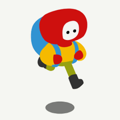

# Canivete Digital — Docker

Versão pronta para **auto-hospedagem com Docker** do Canivete Digital: ferramentas úteis para as pequenas tarefas do dia a dia, reunidas em uma página leve, responsiva e gratuita para rodar no seu próprio computador ou servidor local.

- **Repositório Docker:** [github.com/Kyouz2148/dockercanivetedigital](https://github.com/Kyouz2148/dockercanivetedigital)
- **Repositório principal do projeto:** [github.com/Kyouz2148/canivetedigital](https://github.com/Kyouz2148/canivetedigital)

## Para te ajudar na correria do dia a dia!

<p align="center"></p>

O Canivete é um projeto open source criado para deixar as tarefas do dia a dia um pouco mais fáceis. Sem paywall, sem mistério — e com espaço para todo mundo contribuir.

## Ferramentas incluídas

- **Imagens:** Compressor de imagens, Conversor de arquivos e Redimensionar imagem.
- **PDFs:** PDF para imagem (e imagens para PDF) e Unir e dividir PDF.
- **Utilidades:** Hospedagem temporária de imagens, Gerador de QR Code, Encurtador de links e Sorteador de nomes e números.

## Funcionalidades da interface

- Catálogo visual organizado em Imagens, PDFs e Utilidades, com filtros por categoria.
- Tema claro e escuro, com preferência salva no navegador.
- Layout responsivo para celulares, tablets e computadores.
- Animações GSAP na navegação, nos botões, na identidade visual, na ilustração do canivete e no surgimento das ferramentas durante a rolagem (respeitando `prefers-reduced-motion`).
- Seção dedicada com instruções de Docker para rodar localmente.
- Modal de sugestões de ferramentas, FAQ e informações de privacidade em painéis no rodapé.
- Botão descontraído “Me paga um café?!” para apoiar o projeto via Asaas.
- Favicon e ícones próprios inspirados em um canivete.

## Executar com Docker

### Opção 1: Docker Compose (recomendado)

Com **Docker** e **Docker Compose** instalados, basta clonar este repositório e subir o container:

```bash
git clone https://github.com/Kyouz2148/dockercanivetedigital.git
cd dockercanivetedigital
docker compose up -d --build
```

Para parar o container mantendo os dados salvos no volume:

```bash
docker compose down
```

### Opção 2: Docker CLI

Se preferir usar apenas o comando `docker`:

```bash
git clone https://github.com/Kyouz2148/dockercanivetedigital.git
cd dockercanivetedigital
docker build -t canivete-digital .
docker run -d -p 8080:8080 -v canivete_data:/app/.data --name canivete canivete-digital
```

Depois de subir o container, abra [http://localhost:8080](http://localhost:8080) no navegador.

## Banco de dados e configuração no container

Por padrão, a imagem Docker já vem configurada para usar **SQLite** integrado (`node:sqlite`), sem exigir nenhum banco externo:

| Variável | Valor padrão no Docker | Descrição |
| --- | --- | --- |
| `PORT` | `8080` | Porta HTTP exposta pelo container (`0.0.0.0:8080`). |
| `DB_DRIVER` | `sqlite` | Driver de banco usado pelo servidor dentro do container. |
| `SQLITE_PATH` | `/app/.data/canivete.db` | Caminho do banco SQLite persistido no volume `canivete_data`. |
| `DATABASE_URL` | *(opcional)* | Caso queira usar PostgreSQL em vez de SQLite, defina `DB_DRIVER=postgres` e `DATABASE_URL`. |

> O volume Docker montado em `/app/.data` garante que as imagens temporárias (com expiração automática de até 7 dias) e os links locais (`/s/...`) sejam preservados mesmo se o container for recriado.

## Tecnologias

- **Backend / Container:** Node.js 24 (`node:24-slim`), servidor HTTP integrado (`node:http`), banco SQLite nativo (`node:sqlite`) e `sharp` para conversão/otimização WebP.
- **Frontend:** HTML, CSS e JavaScript sem framework.
- **Bibliotecas incluídas em `assets/`:** `qrcode-generator`, `pdf.js`, `pdf-lib` e `fflate`.
- **Animações e fontes:** GSAP, ScrollTrigger, ScrollToPlugin, dotLottie Player e Google Fonts (DM Sans e Manrope). A animação do README está incluída no repositório como GIF para ser exibida pelo GitHub.

## Estrutura

```text
.
├── .dockerignore              # Arquivos ignorados no build da imagem Docker
├── .gitignore
├── Dockerfile                 # Imagem Node.js 24 com SQLite e Sharp prontos
├── docker-compose.yml         # Serviço canivete com volume persistente em /app/.data
├── app.js                     # Catálogo, filtros, tema, navegação e interações
├── assets/
│   ├── coffee-cup.gif         # Animação do botão de apoio, servida localmente
│   ├── fflate.min.js          # Compactação ZIP no navegador (PDF para imagem)
│   ├── para-te-ajudar.gif     # Conversão da animação Lottie para exibição no GitHub
│   ├── pdf-lib.min.js         # Manipulação e geração de PDFs no navegador
│   ├── pdf.min.js             # Renderização de páginas PDF no navegador
│   ├── pdf.worker.min.js      # Worker do PDF.js
│   └── qrcode-generator.js    # Geração de QR Codes no navegador
├── compressor.*               # Compressor de imagens
├── conversor.*                # Conversor de arquivos e imagens
├── encurtador.*               # Encurtador de links
├── favicon.svg                # Ícone da aba do navegador
├── hospedagem-imagens.*       # Hospedagem temporária de imagens (até 500 KB / 7 dias)
├── index.html                 # Página principal
├── package.json               # Dependências (sharp, pg) e script npm start
├── package-lock.json
├── pdf-imagem.*               # Conversor PDF ↔ imagem
├── pdf-organizar.*            # Unir, dividir e organizar PDFs
├── qr-code.*                  # Gerador de QR Code
├── redimensionar.*            # Redimensionador de imagens
├── robots.txt                 # Regras de rastreamento
├── server.js                  # Servidor HTTP + API com suporte a SQLite e PostgreSQL
├── sitemap.xml                # Sitemap para mecanismos de busca
├── sorteador.*                # Sorteador com animação comemorativa
├── styles.css                 # Estilos, temas e layouts responsivos
└── README.md
```

## Privacidade

- **Processamento local:** Compressor, Conversor, Redimensionador de imagens, PDF para imagem, Unir e dividir PDF, Gerador de QR Code e Sorteador executam todo o processamento diretamente no navegador, sem enviar arquivos para o servidor.
- **Hospedagem de imagens:** arquivos enviados (máximo de 500 KB) são convertidos para WebP compacto e armazenados no SQLite do seu container (`/app/.data/canivete.db`) apenas pelo prazo escolhido (no máximo 7 dias), sendo excluídos automaticamente ao expirar.
- **Encurtador de links:** no modo ultra curto, a URL é encurtada via provedor público (`is.gd`, com fallback `v.gd` / `tinyurl.com`); no modo local (`/s/...`), apenas a URL de destino e o total de cliques são armazenados no seu banco.
- **Preferências locais:** a escolha de tema claro/escuro e o histórico local ficam salvos apenas no navegador. O botão de apoio abre o Asaas em outra aba.

## Contribuir

1. Faça um fork do repositório.
2. Crie uma branch para sua alteração.
3. Faça as mudanças e abra um pull request com uma descrição clara.

Para propostas maiores, use a opção **Sugestões de ferramentas? Fale conosco!** no site ou abra uma issue no GitHub.

## Licença

Este repositório ainda não contém um arquivo de licença. Uma licença precisa ser escolhida e adicionada para definir como outras pessoas podem reutilizar e distribuir o código.